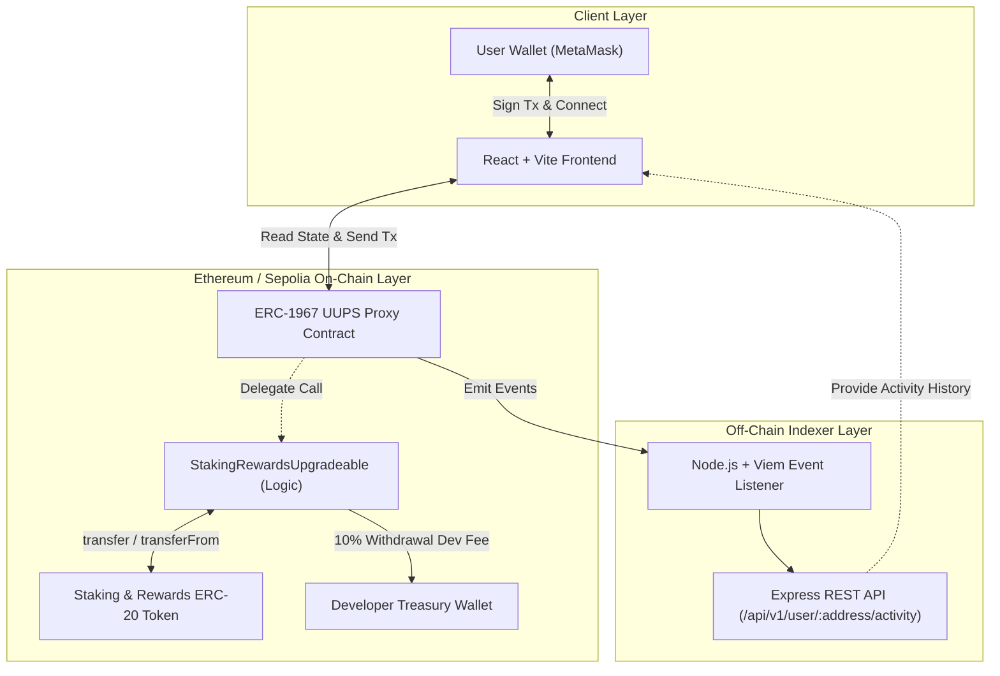

# Staking Protocol (UUPS Upgradeable)

[](https://docs.soliditylang.org/)
[](https://hardhat.org/)
[](https://openzeppelin.com/)
[](https://react.dev/)
[](https://vitejs.dev/)
[](https://viem.sh/)
[](https://opensource.org/licenses/MIT)

A production-ready, full-stack Web3 staking protocol based on the **Synthetix Staking Rewards** model. It features a **UUPS-upgradeable** smart contract architecture, time-locked stakes, automated developer withdrawal fees, an interactive **React + Vite** frontend, and an off-chain **Viem-powered event indexer and REST API**.

---

## Table of Contents

- [Overview](#overview)
- [Key Features](#key-features)
- [System Architecture](#system-architecture)
- [Smart Contracts Deep Dive](#smart-contracts-deep-dive)
  - [Reward Mathematics (Synthetix Model)](#reward-mathematics-synthetix-model)
  - [Time Lock & Dev Fee Mechanism](#time-lock--dev-fee-mechanism)
  - [UUPS Upgradeability Pattern](#uups-upgradeability-pattern)
- [Project Structure](#project-structure)
- [Prerequisites](#prerequisites)
- [Environment Configuration](#environment-configuration)
- [Quick Start Guide](#quick-start-guide)
  - [1. Install Dependencies](#1-install-dependencies)
  - [2. Compile Smart Contracts](#2-compile-smart-contracts)
  - [3. Run the Test Suite](#3-run-the-test-suite)
- [Deployment & Operational Lifecycle](#deployment--operational-lifecycle)
  - [1. Deploy UUPS Proxy Contract](#1-deploy-uups-proxy-contract)
  - [2. Mint Test Tokens](#2-mint-test-tokens)
  - [3. Fund Rewards Pool](#3-fund-rewards-pool)
  - [4. Notify Rewards Distribution](#4-notify-rewards-distribution)
  - [5. Verify on Etherscan](#5-verify-on-etherscan)
  - [6. Upgrade Contract Logic](#6-upgrade-contract-logic)
- [Frontend Application](#frontend-application)
- [Off-Chain Backend & Event Indexer](#off-chain-backend--event-indexer)
- [Security Considerations](#security-considerations)
- [License](#license)

---

## Overview

Traditional staking contracts often struggle with gas-expensive iteration loops when distributing rewards to large numbers of stakers. This protocol implements the battle-tested **Synthetix continuous reward distribution algorithm**, calculating token rewards per second in constant $O(1)$ time regardless of the number of participants.

In addition, the protocol incorporates:
1. **Time-based Lock Periods**: Users commit their tokens for a designated locking duration before being eligible for principal withdrawals.
2. **Protocol Revenue Sharing**: A 10% developer fee is deducted upon principal withdrawal and routed directly to a dedicated developer wallet.
3. **UUPS Proxy Upgradeability**: The implementation logic can be seamlessly upgraded without affecting staked balances, reward counters, or user states.
4. **End-to-End Web3 Stack**: Complete with automated deployment and funding scripts, a live countdown-enabled React frontend, and an off-chain indexed activity log service.

---

## Key Features

- **UUPS Upgradeable Architecture**: Built on OpenZeppelin's Universal Upgradeable Proxy Standard (`UUPSUpgradeable`), isolating storage from execution logic.
- **Gas-Efficient Synthetix Math**: Accrues rewards per-token per-second dynamically without state loops.
- **Time-Locked Withdrawals**: Configurable lock periods (`lockDuration`) enforce holding periods before users can unstake.
- **10% Developer Fee**: Automatic fee deduction upon withdrawal to sustain ongoing protocol development and maintenance.
- **Solvency Protection**: `notifyRewardAmount` validates that the contract holds sufficient reward tokens to cover the distribution schedule before starting the emission window.
- **Upgrade-Safe Reentrancy Protection**: Custom storage-safe non-reentrant guard designed specifically for upgradeable proxies.
- **Interactive Web3 Frontend**: React 18 + Vite dApp featuring MetaMask connection, token approval workflows, dynamic balance cards, and live time-lock countdown progress bars.
- **Persistent Event Indexer**: Off-chain Node.js/TypeScript service with Viem that incrementally scans staking events, stores them in SQLite, and resumes from a persisted block cursor.

---

## System Architecture



---

## Smart Contracts Deep Dive

### Reward Mathematics (Synthetix Model)

The staking rewards contract computes rewards using the following formulas:

1. **Last Time Reward Applicable**:
   $$\text{lastTimeRewardApplicable}() = \min(\text{block.timestamp}, \text{finishAt})$$

2. **Reward Per Token Stored**:
   $$R(t) = R_{\text{stored}} + \frac{R_{\text{rate}} \times (\text{lastTimeRewardApplicable}() - t_{\text{updated}}) \times 10^{18}}{\text{totalSupply}}$$

3. **Earned Rewards per User**:
   $$\text{Earned}(u) = \frac{\text{balanceOf}[u] \times (R(t) - \text{userRewardPerTokenPaid}[u])}{10^{18}} + \text{rewards}[u]$$

Whenever a user stakes, withdraws, or claims rewards, the `updateReward` modifier syncs $R(t)$, assigns accrued rewards to the user, and sets their paid threshold to $R(t)$.

### Time Lock & Dev Fee Mechanism

- **Lock Duration**: When a user deposits via `stake(amount)`, the contract records `stakeTime[msg.sender] = block.timestamp`. A user cannot withdraw until:
  $$\text{block.timestamp} \ge \text{stakeTime}[\text{msg.sender}] + \text{lockDuration}$$
- **10% Developer Fee**: Upon calling `withdraw(amount)`:
  - Developer Fee = $(\text{amount} \times 10) / 100$
  - Net User Payout = $\text{amount} - \text{devFee}$
  - `devFee` is immediately transferred to `devWallet`.
  - Net tokens are transferred back to the user.

### UUPS Upgradeability Pattern

The contract inherits from OpenZeppelin's `UUPSUpgradeable` and `Initializable`:
- The proxy holds all contract storage and balances.
- Logic is encapsulated inside `StakingRewardsUpgradeable.sol`.
- Upgrade authorization is strictly gated by `_authorizeUpgrade(address newImplementation) internal override onlyOwner`.
- The constructor calls `_disableInitializers()` to prevent the implementation contract itself from being initialized.

---

## Project Structure

```
Staking-contract/
├── contracts/                        # Solidity smart contracts
│   ├── MockToken.sol                 # Mintable ERC-20 token for development & testing
│   └── StakingRewardsUpgradeable.sol # Core UUPS-upgradeable staking rewards contract
├── scripts/                          # Hardhat deployment & admin scripts
│   ├── deploy.js                     # Deploys UUPS Proxy & implementation
│   ├── upgrade.js                    # Upgrades existing proxy to a new implementation
│   ├── mint.js                       # Mints test tokens to deployer/user
│   ├── fund-contract.js              # Funds staking contract with reward tokens
│   └── notify.js                     # Initiates rewards emission period
├── test/                             # Automated test suite
│   └── StakingContract.test.js       # 9 comprehensive tests across 6 modules
├── frontend/                         # React 18 + Vite frontend
│   ├── src/
│   │   ├── components/               # Navbar & StakingApp components
│   │   ├── config/contracts.js       # Addresses & ABI bindings
│   │   ├── context/WalletContext.jsx # EIP-1193 MetaMask connection context
│   │   ├── App.jsx                   # Main application root
│   │   └── main.jsx                  # Entry point
│   ├── package.json
│   └── vite.config.js
├── backend/                          # Off-chain event indexing service
│   ├── src/
│   │   └── index.ts                  # Viem event listener & Express REST API
│   ├── package.json
│   └── tsconfig.json
├── hardhat.config.js                 # Hardhat configuration (Cancun EVM, 0.8.26)
├── package.json                      # Root workspace scripts & dependencies
├── .env.example                      # Root environment variables template
└── README.md                         # Project documentation
```

---

## Prerequisites

Ensure you have the following installed on your environment:

- **Node.js**: `>= 18.0.0`
- **npm**: `>= 9.0.0`
- **MetaMask**: Browser extension for frontend Web3 interaction
- **Sepolia RPC**: An active RPC URL from [Alchemy](https://www.alchemy.com/), [Infura](https://www.infura.io/), or a public provider
- **Testnet ETH**: Sepolia ETH to cover deployment and execution gas costs

---

## Environment Configuration

### Root Workspace (`.env`)

Copy `.env.example` to `.env` in the root folder:

```bash
cp .env.example .env
```

Configure the following parameters:

| Variable | Required | Description | Example |
|---|---|---|---|
| `SEPOLIA_RPC_URL` | Yes | HTTP RPC URL for the Sepolia testnet | `https://eth-sepolia.g.alchemy.com/v2/...` |
| `PRIVATE_KEY` | Yes | Deployer wallet private key (never commit) | `0xabcdef...` |
| `ETHERSCAN_API_KEY` | Optional | Etherscan API key for contract verification | `ABC123XYZ...` |
| `TOKEN_ADDRESS` | Yes | ERC-20 staking and reward token address | `0x0D15D5f0781367938B8C2437A1F86ac3B810Bb8c` |
| `LOCK_DURATION` | Yes | Stake lock duration in seconds | `604800` (7 days) or `60` (testing) |
| `REWARDS_DURATION` | No | Emission window in seconds (default: 86400) | `86400` (1 day) |
| `STAKING_PROXY_ADDRESS` | Post-deploy| Deployed proxy address for scripts and frontend | `0x5D03049E1DFa6Ffe799b599F13B576D5BEf99474` |

### Backend Workspace (`backend/.env`)

Copy `backend/.env.example` to `backend/.env`:

```bash
cp backend/.env.example backend/.env
```

| Variable | Description | Default |
|---|---|---|
| `PORT` | Local port for Express API | `5000` |
| `SEPOLIA_RPC_URL` | Sepolia RPC endpoint for Viem client | `https://ethereum-sepolia-rpc.publicnode.com` |
| `STAKING_PROXY_ADDRESS` | Deployed proxy address to listen for events | `0x...` |
| `DEPLOYMENT_BLOCK` | Block number where proxy was deployed (speeds up historical sync) | `5000000` |

---

## Quick Start Guide

### 1. Install Dependencies

Install root, frontend, and backend packages:

```bash
# 1. Install root Hardhat dependencies
npm install

# 2. Install frontend dependencies
cd frontend && npm install && cd ..

# 3. Install backend dependencies
cd backend && npm install && cd ..
```

### 2. Compile Smart Contracts

Compile the Solidity contracts using Hardhat:

```bash
# Compile contracts
npx hardhat compile

Contracts target Solidity `0.8.26` with Cancun EVM settings and 200 optimizer runs.

### 3. Run the Test Suite

Execute the automated test suite:

```bash
npx hardhat test
```

#### Test Coverage Summary:
- **Module 1: State Setup**: Verifies proxy initialization, variable assignments, and double-initialization prevention.
- **Module 2: Synthetix Math View Functions**: Confirms zero baseline values for empty pools and non-stakers.
- **Module 4: Core User Functions**: Validates token deposits, time-lock enforcement, 10% dev fee deduction on withdrawal, and claiming accrued rewards.
- **Module 5: Admin Functions**: Validates reward emission initialization and reward rate calculation.
- **Module 6: Upgradeability & Security**: Upgrades the proxy to a new implementation and asserts complete state balance retention.

---

## Deployment & Operational Lifecycle

The protocol includes complete automation scripts to take the system from local simulation to live testnet operation.

### 1. Deploy UUPS Proxy Contract

Ensure `TOKEN_ADDRESS`, `LOCK_DURATION`, and `REWARDS_DURATION` are set in `.env`:

```bash
# Local deployment
npx hardhat run scripts/deploy.js --network localhost

# Sepolia testnet deployment
npx hardhat run scripts/deploy.js --network sepolia
```

This deploys the implementation contract and initializes the ERC-1967 proxy via OpenZeppelin Upgrades. Note the output **StakingRewards Proxy deployed to** address and copy it into:
- `.env` (`STAKING_PROXY_ADDRESS`)
- `frontend/src/config/contracts.js` (`STAKING_CONTRACT_ADDRESS`)
- `backend/.env` (`STAKING_PROXY_ADDRESS`)

### 2. Mint Test Tokens

If testing on Sepolia or a local node with `MockToken`:

```bash
npx hardhat run scripts/mint.js --network sepolia
```

Mints 50,000 tokens to the deployer wallet address.

### 3. Fund Rewards Pool

The contract requires reward tokens in its balance before initiating a reward distribution period:

```bash
npx hardhat run scripts/fund-contract.js --network sepolia
```

Transfers reward tokens from the deployer wallet directly to the staking contract proxy.

### 4. Notify Rewards Distribution

Activate the reward distribution window by setting the reward amount:

```bash
npx hardhat run scripts/notify.js --network sepolia
```

Calls `notifyRewardAmount(reward)`. The contract calculates `rewardRate = reward / rewardsDuration` and activates the distribution countdown.

### 5. Verify on Etherscan

Verify your contracts on Etherscan (Sepolia):

```bash
# Verify implementation contract
npx hardhat verify --network sepolia <IMPLEMENTATION_ADDRESS>
```

*(OpenZeppelin UUPS proxies can also be linked on Etherscan using the "Is this a proxy?" option on the contract page).*

### 6. Upgrade Contract Logic

To upgrade the proxy logic to a new implementation without touching user balances or contract state:

```bash
npx hardhat run scripts/upgrade.js --network sepolia
```

---

## Frontend Application

The frontend is a modern single-page dApp built with React and Vite.

### Running the Frontend

```bash
cd frontend
npm run dev
```

Navigate to `http://localhost:5173`.

### Features & UI Capabilities
1. **Wallet Connection**: Connects to MetaMask or any EIP-1193 compatible Web3 wallet.
2. **Dynamic Live Stats**:
   - Wallet Balance
   - Active Staked Balance
   - Accrued Rewards (updates in real-time)
3. **Lock Countdown & Visual Progress Bar**: Displays remaining lock time and unlocks actions when `block.timestamp >= stakeTime + lockDuration`.
4. **Token Approval & Staking**: Two-step flow checks existing allowance and prompts token approval before staking.
5. **Withdrawal Notice**: Alerts the user of the 10% developer fee deducted upon unstaking.
6. **One-Click Reward Claiming**: Directly claims all pending rewards without unstaking principal.

---

## Off-Chain Backend & Event Indexer

The backend service indexes `Staked`, `Withdrawn`, `RewardPaid`, and `RewardAdded` events. SQLite stores the event ledger, per-user aggregates, and the last fully processed block. The sync loop retries failed ranges and safely replays saved events after a restart.

### Running the Backend

```bash
cd backend
npm run dev
```

The server will start on `http://localhost:5000`. It scans from `DEPLOYMENT_BLOCK` through the latest block in chunks, then polls for new blocks every five seconds. Its health endpoint reports the persisted cursor.

### API Reference

#### Health and sync cursor

```http
GET /api/v1/health
```

#### Get User Staking Activity
Returns up to 100 most recent indexed events for a given wallet address. `amount` is the raw token integer string; clients should format it using the token's decimals.

```http
GET /api/v1/user/:address/activity
```

**Example Response**:

```json
{
  "success": true,
  "user": "0x70997970c51812dc3a010c7d01b50e0d17dc79c8",
  "count": 2,
  "history": [
    {
      "user": "0x70997970C51812dc3A010C7d01b50e0d17dc79C8",
      "type": "STAKE",
      "amount": "100.0",
      "blockNumber": "5812930",
      "transactionHash": "0x3a4b...c91d"
    }
  ]
}
```

#### Get User Statistics

```http
GET /api/v1/user/:address/stats
```

Returns `totalStaked`, `totalWithdrawn`, `totalClaimed`, and `currentStaked` as integer strings, plus the last active block.

The React staking screen reads live balances and submits transactions directly through the connected wallet. It uses the activity endpoint for recent transaction history. Set `VITE_API_BASE_URL` in `frontend/.env` if the API is hosted somewhere other than `http://localhost:5000`.

---

## Security Considerations

- **Initialization Locking**: The logic contract's constructor invokes `_disableInitializers()` to safeguard the implementation from uninitialized takeovers.
- **Upgrade Access Control**: The `_authorizeUpgrade` hook is strictly protected by the `onlyOwner` modifier.
- **Reentrancy Protection**: Employs an upgrade-safe reentrancy guard across all state-mutating functions (`stake`, `withdraw`, `getReward`).
- **Reward Solvency Assertion**: `notifyRewardAmount` asserts that the contract holds sufficient tokens (`rewardRate * rewardsDuration <= balance`) before accepting a reward schedule.
- **Safe State Updates**: Staker reward accruals are always processed via the `updateReward` modifier before balance adjustments occur.

---

## License

This project is licensed under the [MIT License](LICENSE).
